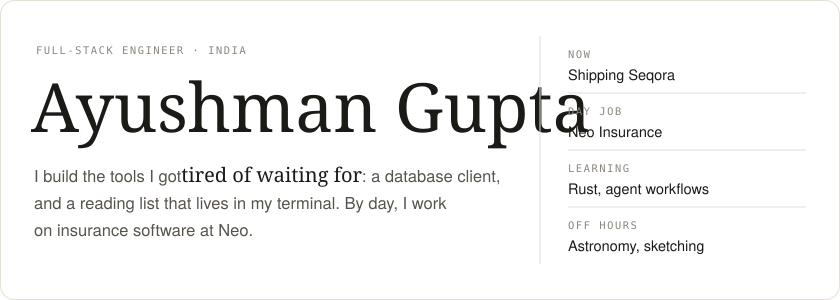
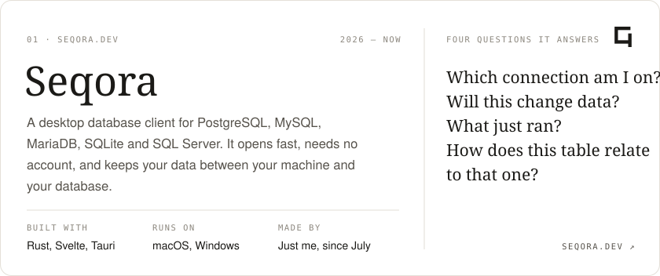
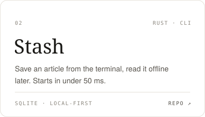
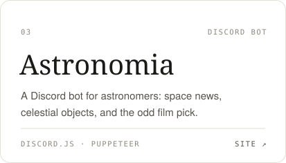
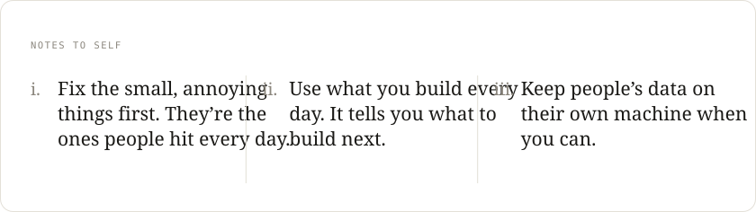
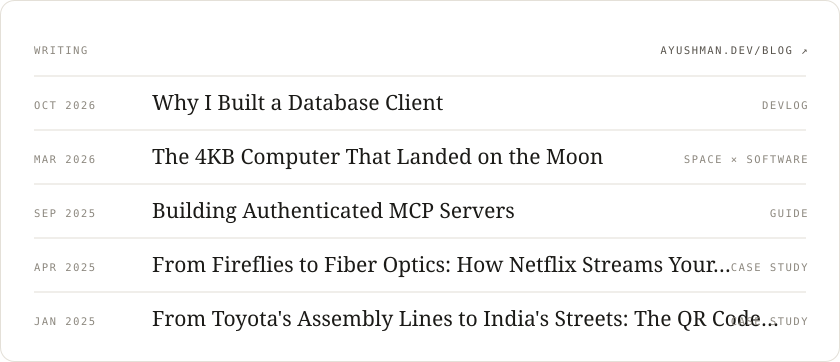
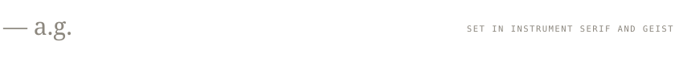

<!-- Generated by scripts/build.py. Edit the copy there and rebuild; don't edit the SVGs. -->

<picture><source media="(prefers-color-scheme: dark)" srcset="assets/hero.dark.svg"></picture>

<a href="https://seqora.dev"><picture><source media="(prefers-color-scheme: dark)" srcset="assets/seqora.dark.svg"></picture></a>

<a href="https://github.com/ayushman-git/stash"><picture><source media="(prefers-color-scheme: dark)" srcset="assets/stash.dark.svg"></picture></a>
<a href="https://ayushman-git.github.io/astronomia-site/"><picture><source media="(prefers-color-scheme: dark)" srcset="assets/astronomia.dark.svg"></picture></a>

<picture><source media="(prefers-color-scheme: dark)" srcset="assets/notes.dark.svg"></picture>

<a href="https://www.ayushman.dev/blog/"><picture><source media="(prefers-color-scheme: dark)" srcset="assets/writing.dark.svg"></picture></a>

<picture><source media="(prefers-color-scheme: dark)" srcset="assets/footer.dark.svg"></picture>

<a href="https://ayushman.dev">ayushman.dev</a> · <a href="https://seqora.dev">seqora.dev</a> · <a href="https://www.linkedin.com/in/ayushman-git/">LinkedIn</a>

